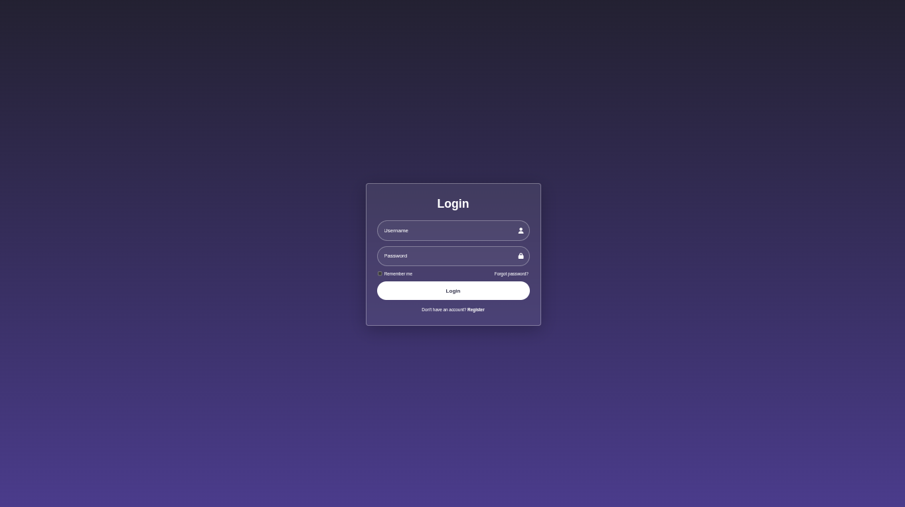
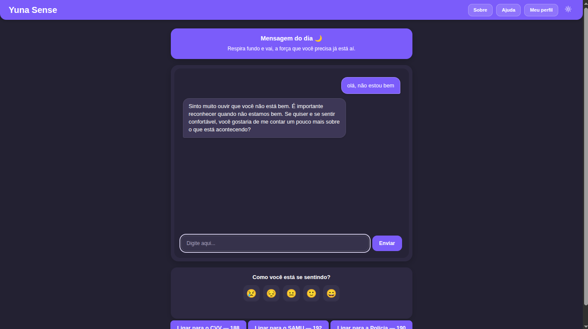
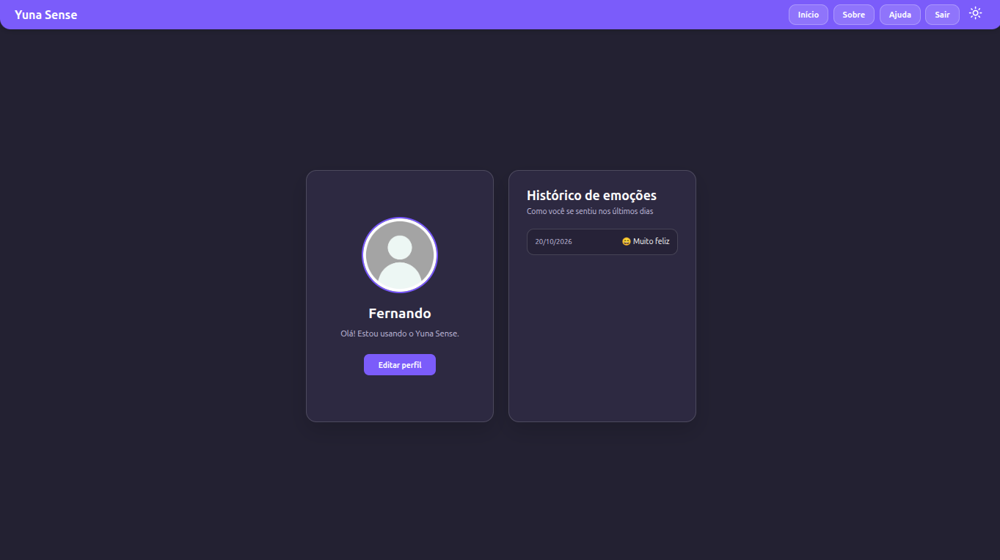

<div align="center">

# 🌙 Yuna Sense


**Um chatbot de apoio emocional desenvolvido com Python, Flask e inteligência artificial.**

</div>

## 📑 Índice

- [Sobre o projeto](#-sobre-o-projeto)
- [Demonstração](#-demonstração)
- [Funcionalidades](#-funcionalidades)
- [Tecnologias utilizadas](#️-tecnologias-utilizadas)
- [Estrutura do projeto](#-estrutura-do-projeto)
- [Pré-requisitos](#️-pré-requisitos)
- [Como executar o projeto](#-como-executar-o-projeto)
- [Objetivo do projeto](#-objetivo-do-projeto)
- [Aprendizados](#-aprendizados)
- [Melhorias futuras](#-melhorias-futuras)
- [Autor](#-autor)
- [Licença](#-licença)

## 📌 Sobre o projeto

O Yuna Sense é um projeto acadêmico desenvolvido como Trabalho de Conclusão de Curso (TCC) do curso de Desenvolvimento de Sistemas. A aplicação utiliza inteligência artificial para proporcionar conversas acolhedoras, com foco em escuta e apoio emocional.

## 📸 Demonstração

<div align="center">

### Tela inicial



### Chatbot



### Perfil



</div>

## ✨ Funcionalidades

- 💬 Chat interativo com inteligência artificial.
- 🤖 Integração com a API do Google Gemini.
- 🔐 Cadastro e autenticação de usuários.
- 🔒 Armazenamento de senhas com hash.
- 👤 Perfil de usuário com informações editáveis.
- 💾 Persistência de dados em banco de dados.
- 🎨 Interface personalizada com tema escuro e identidade visual própria.

## 🛠️ Tecnologias utilizadas

### Back-end

- Python
- Flask
- SQLAlchemy
- SQLite
- Google Gemini API

### Front-end

- HTML5
- CSS3
- JavaScript

### Ferramentas

- Git
- GitHub
- Visual Studio Code

## 📂 Estrutura do projeto

```text
Yuna-Sense/
├── Backend/
│   ├── chat.py
│   ├── models.py
│   ├── templates/
│   ├── static/
│   ├── requirements.txt
│   └── .env.example
├── .gitignore
├── LICENSE
└── README.md
```

## ⚙️ Pré-requisitos

- Python instalado.
- Git instalado.
- Uma chave de API do Google Gemini.

## 🚀 Como executar o projeto

### 1. Clone o repositório

```bash
git clone https://github.com/fagpc044/Yuna-Sense.git
```

### 2. Acesse a pasta do projeto

```bash
cd Yuna-Sense/Backend
```

### 3. Crie um ambiente virtual

```bash
python -m venv venv
```

No Linux, ative o ambiente virtual:

```bash
source venv/bin/activate
```

### 4. Instale as dependências

```bash
pip install -r requirements.txt
```

### 5. Configure as variáveis de ambiente

Crie um arquivo `.env` com as variáveis necessárias:

```env
SECRET_KEY=sua_chave_secreta
MINHA_CHAVE=sua_chave_da_api
```

Configure outras variáveis, como `DATABASE_URL`, caso sejam utilizadas.

**Importante:** nunca publique chaves de API, senhas ou outras informações secretas no GitHub. Mantenha o arquivo `.env` fora do repositório utilizando o `.gitignore`.

### 6. Execute a aplicação

```bash
python chat.py
```

Acesse o endereço local exibido no terminal.

## 🎯 Objetivo do projeto

Aplicar conhecimentos de desenvolvimento web, integração com inteligência artificial, autenticação de usuários, gerenciamento de dados e construção de interfaces.

## 🧠 Aprendizados

- Desenvolvimento de aplicações web com Flask.
- Criação e integração de rotas.
- Integração com APIs de inteligência artificial.
- Modelagem e persistência de dados.
- Autenticação e gerenciamento de sessões.
- Desenvolvimento de interfaces com HTML, CSS e JavaScript.
- Versionamento de código com Git e GitHub.

## 🔮 Melhorias futuras

- [ ] Aprimorar a interface e a experiência do usuário.
- [ ] Implementar novas funcionalidades.
- [ ] Melhorar a organização e a manutenção do código.
- [ ] Expandir os recursos de personalização do perfil.

## 👨‍💻 Autor

**Fernando Arthur**

<div align="left">

[](https://github.com/fagpc044)

[](https://www.linkedin.com/in/fernandoarthur172231/)

</div>

## 📄 Licença

Este projeto está licenciado sob a licença MIT. Consulte o arquivo [LICENSE](LICENSE) para mais informações.
